# Urras


A fast, native Git client for Windows and Linux. No Electron: C# on .NET with an Avalonia interface, running the `git`
you already have installed.

**Status:** early development. First version with the basic Git workflow.

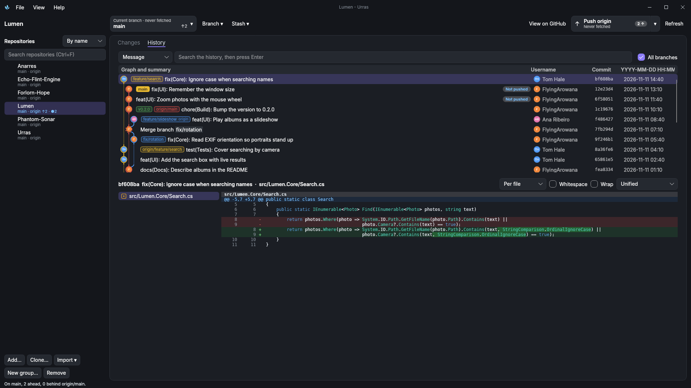

## Features

- Repository list: add existing folders, create new repositories, clone
- Repository groups: by name (each repository with its forks and clones inside), by folder, by owner, or a
  manual layout you can rename and reorder; pin repositories and folders to the top (marked [P]) and to the
  toolbar; fetch or pull a whole group; each repository shows its branch, remote, commits to push and pull,
  and uncommitted changes
- Changes: unstaged and staged files, stage and unstage (selected or all), discard with confirmation
- Co-authors on commits (Co-authored-by lines), picked from people in the history, typed as Name <email>, or
  found as @username with a GitHub account
- Import many repositories at once: everything in a folder, GitHub Desktop's list, or cloned from GitHub
- Accounts on GitHub, GitHub Enterprise, GitLab, Gitea (Forgejo, Codeberg), Bitbucket and Bitbucket Server,
  with tokens in the system's credential store: profile pictures, pull requests (list, check out, create),
  notifications, and cloning your repositories
- Sign in to GitHub through the browser, like GitHub Desktop; GitLab and GitHub Enterprise too once registered
  ([docs/oauth.md](docs/oauth.md)), and a personal access token for everything else
- Stage, unstage or discard single lines or whole hunks: select lines in the diff and right-click
- Diffs for modified, new, deleted and renamed files, as unified (with line numbers), split (side by side) or raw
  `git` output; the choice is saved
- Markdown files rendered, old and new side by side with changed blocks marked (Preview switch)
- Syntax colours for common languages, word-level highlights in changed lines, optional whitespace and
  CRLF/LF markers, wrapped or scrolling lines
- Commits shown per file (a list of changed files) or combined; images compared side by side, as a swipe or
  as an onion skin
- Commit with summary and description, amend the last commit (Ctrl+Enter to commit)
- History with the full diff of each commit, a commit graph with branch lanes across every branch, and badges
  for branches, remote branches and tags
- Branches: switch, create, delete, check out remote branches
- Fetch, pull and push, with ahead and behind counts; first push publishes the branch
- Filter the change list, hide untracked files, and see line-ending problems (checked against `.gitattributes`
  and `.editorconfig`) before they are committed
- Commit message helpers: summary length counter, recent messages, and the repository's commit template
- Open repositories and files in the file explorer, a terminal or VS Code; copy paths and commit SHAs
- Background fetching of every repository (Settings)
- Tags, checking out a commit, revert, cherry-pick, stashes, merge and rebase
- Bisect from History with a banner to mark commits; submodules, worktrees and Git LFS (with locks) from
  the Branch menu
- Interactive rebase from History: reorder, reword, edit, squash, fix up or drop commits, with a backup tag
- Conflict helper: a banner while a merge, rebase, cherry-pick or revert is stopped, taking one side or marking
  files resolved, then Continue or Abort
- Conflict view: both sides of every conflict next to each other, a choice per conflict and the result below
- Repository settings: line-ending rules written to `.gitattributes` and `.editorconfig`, and normalizing
  existing files after previewing them
- Looking into the past: history of a file or folder, blame, browsing the files at any commit, searching commits
  by message, author, file or content, comparing two commits (Ctrl+click) or a branch, and the reflog for
  finding lost commits
- Quick Launch (Ctrl+P): open a repository, switch branch or run a command by typing a few letters
- Search the repository list (Ctrl+F) by name, folder or group; Enter opens the first one found
- View a repository on GitHub, GitLab, Bitbucket or Codeberg; forks ask once, like GitHub Desktop, whether they
  contribute to the parent or are for your own purposes, and say what you can push to
- Uncommitted changes can stay with their branch: put away when you switch, back when you return
- Refreshes when something changes on disk, not every time the window comes back, so it stays quick with many
  repositories
- Settings backed up every day for a week (`%APPDATA%\Urras\backups`), and unexpected errors written to
  `crash.log` instead of closing Urras
- Custom commands: run builds, scripts or other tools from the menus, with the repository, branch, file or
  commit filled in
- Statistics: contributors, when commits happen and which files change most
- Options: accounts, external editor and shell (or your own), Git name, email and default branch, theme, date
  and time formats, tab size, which questions to ask, what happens to changes when switching branch, background
  fetch
- AI assistant with the service of your choice (OpenAI-compatible, Anthropic or a command-line agent): commit
  messages from the staged changes, explaining commits, conflict suggestions; off by default
- Git log panel showing every command Urras runs and its output

## Screenshots

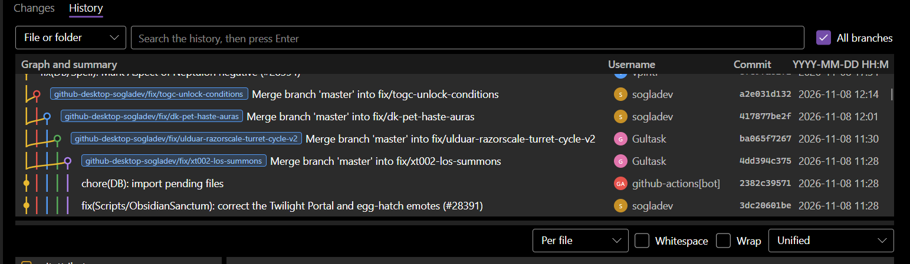<br>
History: the commit graph with a lane per branch, branch labels, authors with their pictures, and the commit and
date of each change

<table>
  <tr>
    <td>
      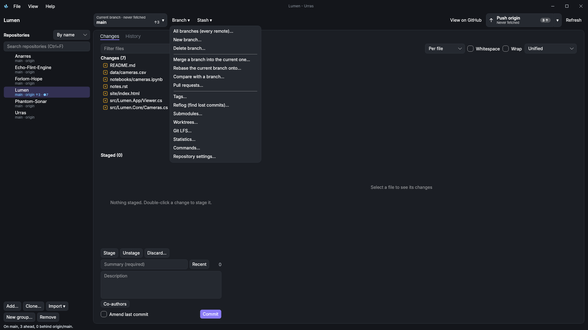<br>
      Branch menu: branches, merge, rebase, pull requests, tags, reflog, submodules, worktrees and more
    </td>
    <td>
      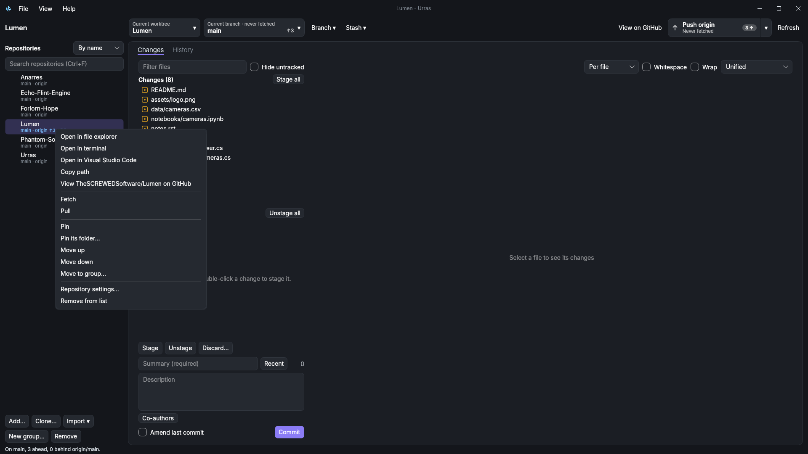<br>
      A repository's menu: open it elsewhere, view it on GitHub, fetch, pull, pin and group
    </td>
  </tr>
  <tr>
    <td>
      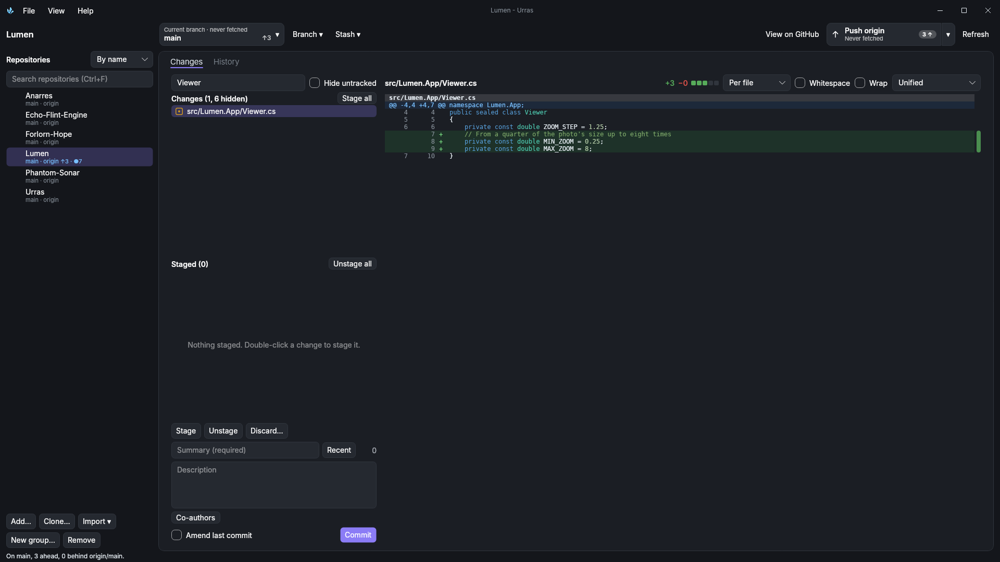<br>
      Filtering the changes by name, with syntax colours in the diff
    </td>
    <td>
      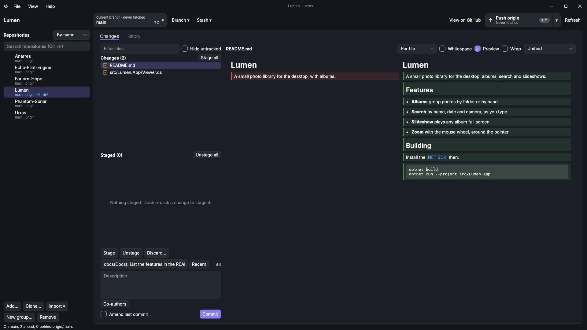<br>
      Markdown rendered instead of shown as text (Preview)
    </td>
  </tr>
  <tr>
    <td>
      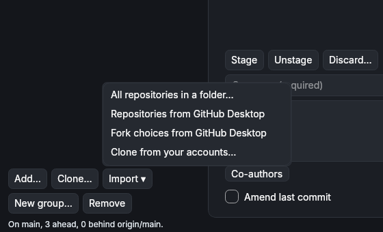<br>
      Import: everything in a folder, GitHub Desktop's list, or clones from your accounts
    </td>
    <td>
      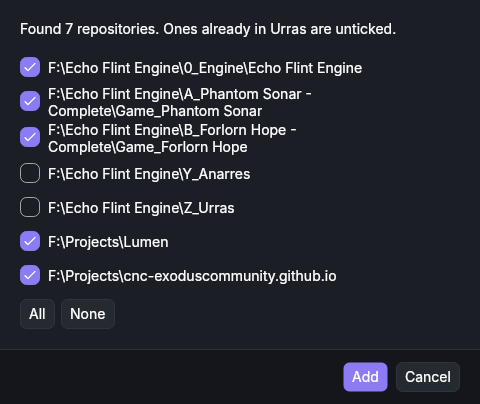<br>
      Choosing which of the repositories found to add
    </td>
  </tr>
  <tr>
    <td>
      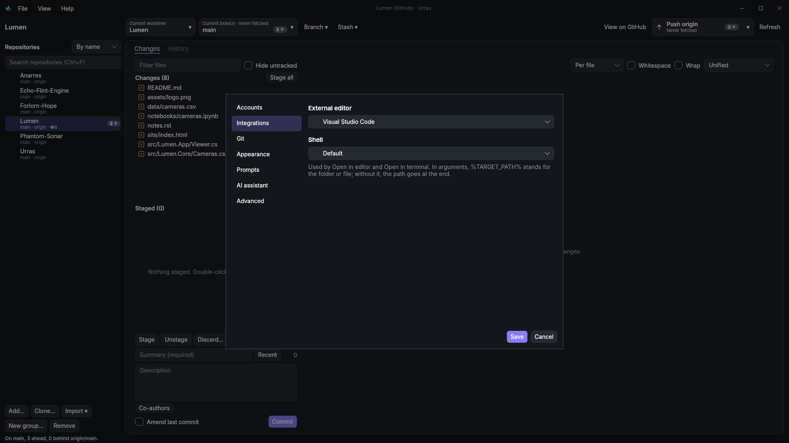<br>
      Options: your editor and shell for "Open in…"
    </td>
    <td>
      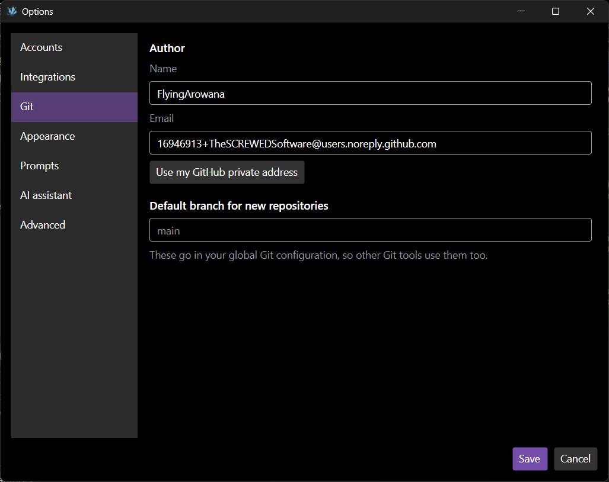<br>
      Options: your Git name, email (or GitHub's private address) and default branch
    </td>
  </tr>
  <tr>
    <td>
      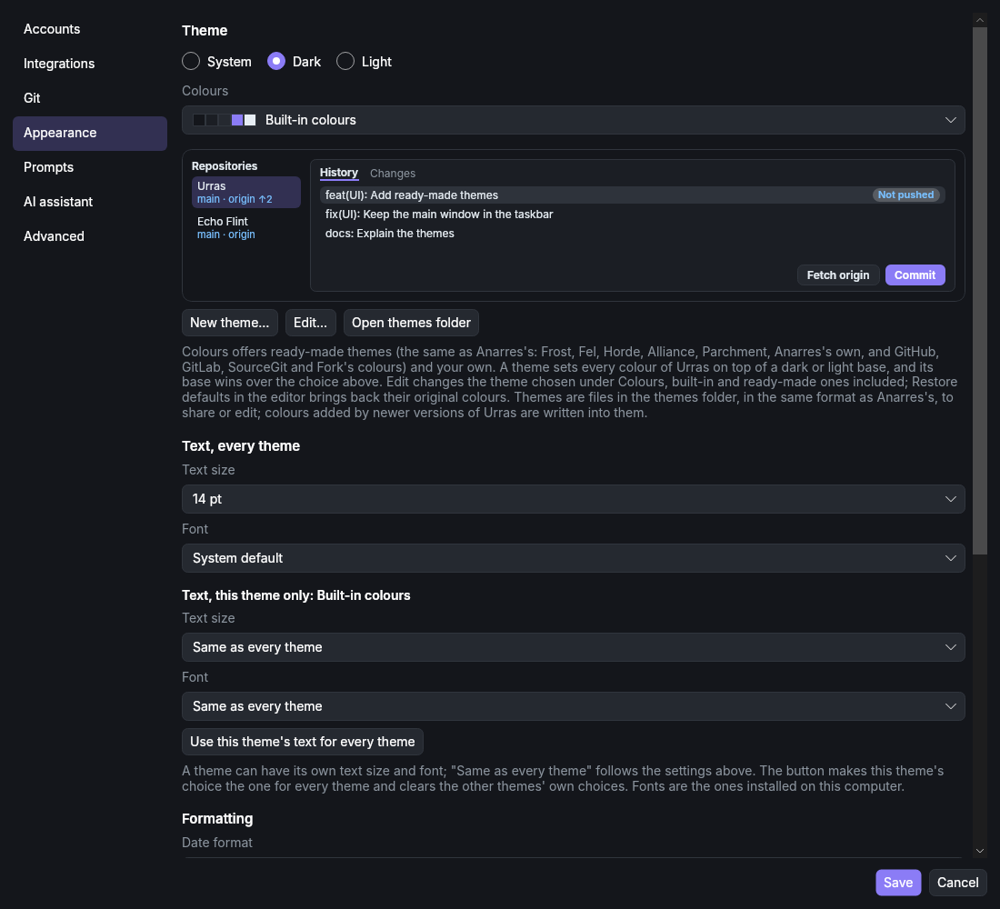<br>
      Options: theme, date and time formats, tab size and scroll bars
    </td>
    <td>
      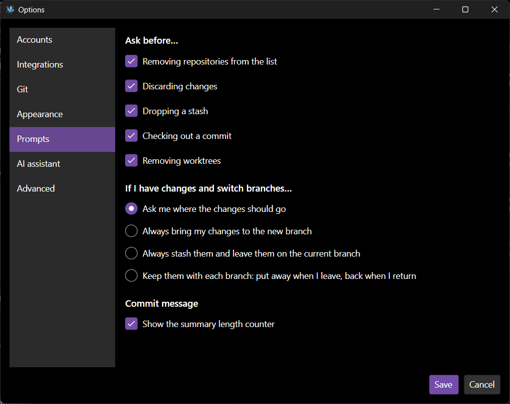<br>
      Options: which questions to ask, and what happens to changes when switching branch
    </td>
  </tr>
  <tr>
    <td>
      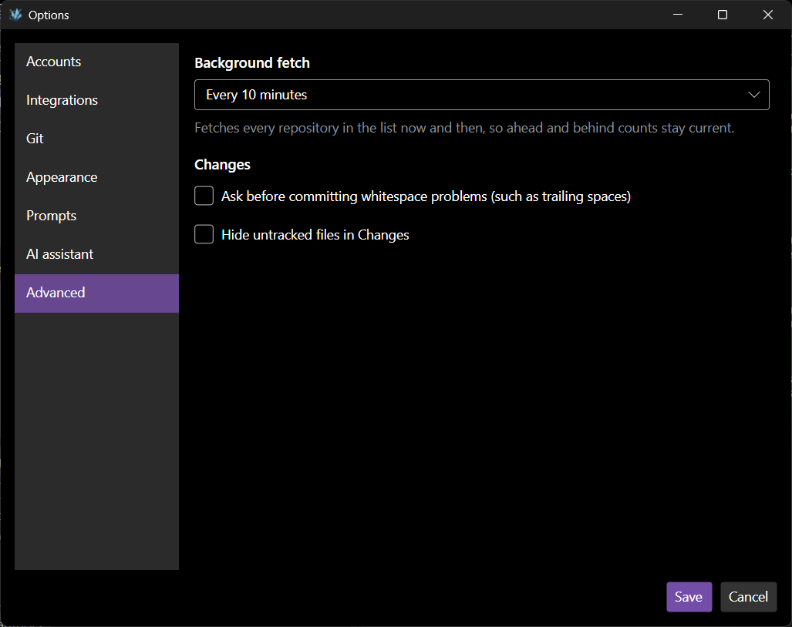<br>
      Options: background fetch and checks before committing
    </td>
    <td>
      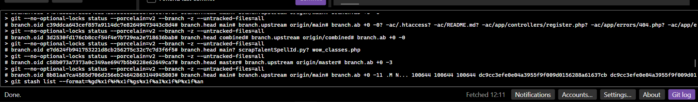<br>
      Git log: every command Urras runs, and what Git answered
    </td>
  </tr>
</table>

## Requirements

- [.NET 10 SDK](https://dotnet.microsoft.com/download) to build
- Git 2.25 or newer: on Windows, [Git for Windows](https://git-scm.com/download/win), which includes Git Credential
  Manager for signing in to GitHub; on Linux, `git` from your package manager plus `git-credential-manager` or
  `git-credential-libsecret`

## Building and running

```
dotnet run --project src/Urras.App
```

Or open `Urras.sln` in Visual Studio or Rider and run `Urras.App`.

Builds default to Release, which is optimised and still has full debug symbols, so breakpoints and stack traces
work (.NET's equivalent of CMake's RelWithDebInfo). Use `-c Debug` for an unoptimised build. Visual Studio and Rider
pick the configuration in their toolbar instead; choose Release there once and they remember it.

To build a standalone app:

```
dotnet publish src/Urras.App -c Release -r win-x64 --self-contained
dotnet publish src/Urras.App -c Release -r linux-x64 --self-contained
```

To publish a release on GitHub, push a version tag; the Release workflow tests Urras, builds the Windows and Linux
downloads and publishes them with notes made from the changes since the last release:

```
git tag v0.2.0
git push origin v0.2.0
```

A tag with a hyphen, such as `v0.2.0-beta.1`, becomes a pre-release.

### Tests

The Git layer (`Urras.Core`) has tests that run against real temporary repositories. Each line shows its place in
the run, PASS in green or FAIL in red, and a failure stays on one line with line endings written out (`\r\n`):

```
dotnet run --project tests/Urras.Core.Tests
```

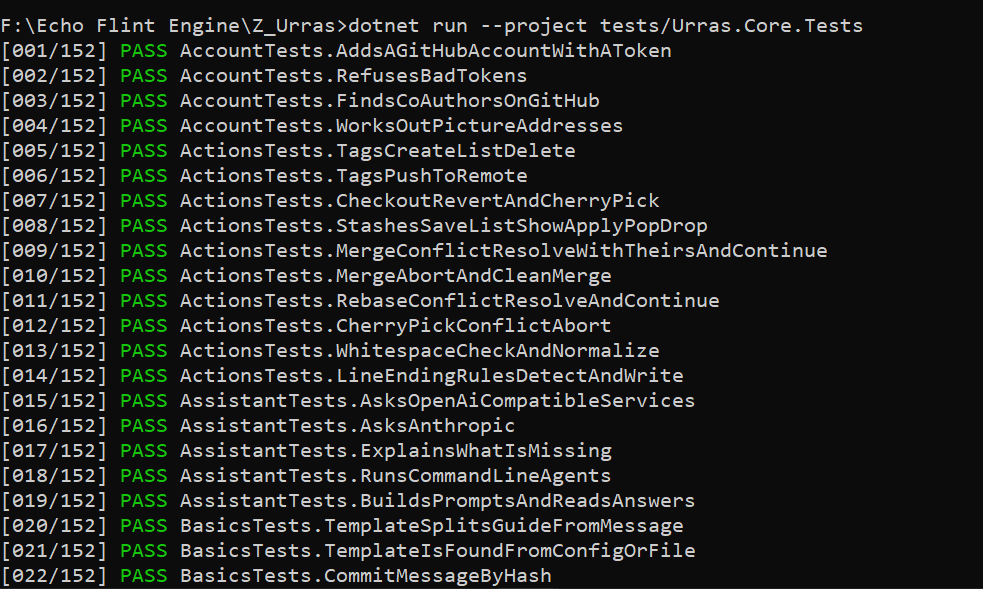<br>
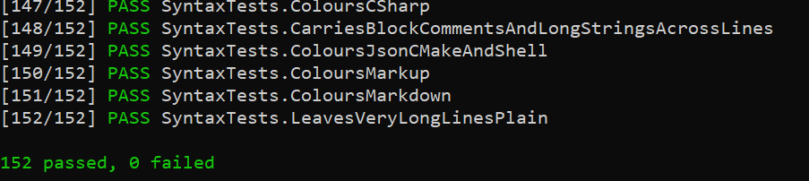

The interface tests open every window and dialog without showing them (Avalonia headless) and fail on any error:

```
dotnet test tests/Urras.App.Tests
```

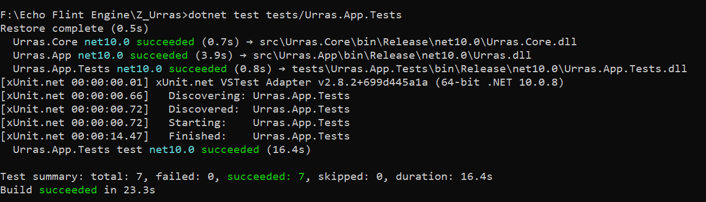

Both use their own settings and Git configuration in a temporary folder, so they never touch yours.

## Structure

```
src/Urras.Core/          Git commands, output parsers, settings. No UI.
src/Urras.App/           Avalonia user interface.
tests/Urras.Core.Tests/  Tests for Urras.Core, with a small built-in runner.
```

Settings (the repository list) are stored in `%APPDATA%\Urras\settings.json` on Windows and
`~/.config/Urras/settings.json` on Linux.

## Contributing

Read [CONTRIBUTING.md](CONTRIBUTING.md) before opening a pull request: it covers the coding standards, commit
messages, tests and the contributor terms. AI-assisted pull requests are allowed, but must be disclosed in the pull
request template.

## Credits

- [Avalonia](https://github.com/AvaloniaUI/Avalonia) (MIT) for the user interface.

## License

Copyright (C) 2026 TheSCREWEDSoftware

Urras is free software: you can redistribute it and/or modify it under the terms of the GNU Affero General Public
License as published by the Free Software Foundation, either version 3 of the License, or (at your option) any later
version.

Urras is distributed in the hope that it will be useful, but WITHOUT ANY WARRANTY; without even the implied warranty
of MERCHANTABILITY or FITNESS FOR A PARTICULAR PURPOSE. See the GNU Affero General Public License for more details.

You should have received a copy of the GNU Affero General Public License along with Urras, in [LICENSE](LICENSE). If
not, see <https://www.gnu.org/licenses/>.
