# Urras


A fast, native Git client for Windows and Linux. No Electron: C# on .NET with an Avalonia interface, running the `git`
you already have installed.

**Status:** early development. First version with the basic Git workflow.


## Contents

- [Run it yourself](#run-it-yourself)
  - [What you need](#what-you-need)
  - [Get the code](#get-the-code)
  - [Run it](#run-it)
  - [Build a standalone app](#build-a-standalone-app)
  - [Run the tests](#run-the-tests)
- [Features](#features)
- [For maintainers: build types and releases](#for-maintainers-build-types-and-releases)
- [Project layout and settings](#project-layout-and-settings)
- [Contributing](#contributing)
- [Credits](#credits)
- [License](#license)

The ▸ sections below open and close when you click their titles.

## Run it yourself

### What you need

| You need | Windows | Linux |
|---|---|---|
| .NET 10 SDK, to build | [Download](https://dotnet.microsoft.com/download) | Same download, or your package manager |
| Git 2.25 or newer | [Git for Windows](https://git-scm.com/download/win) | `git` from your package manager |
| Signing in to sites | Comes with Git for Windows | `git-credential-manager` or `git-credential-libsecret` |

Check that both are found by opening a terminal and running `dotnet --version` (10.0 or newer) and `git --version`.

### Get the code

```
git clone https://github.com/TheSCREWEDSoftware/Urras.git
cd Urras
```

### Run it

**Windows, the easy way:** double-click `start.bat`. It builds Urras and opens it in its own window; if Urras is
already open it asks to close it first (Enter means yes), and it tells you if Urras closes right after starting.

**Any system, from a terminal** in the Urras folder:

```
dotnet run --project src/Urras.App
```

**From an IDE:** open `Urras.sln` in Visual Studio or Rider and run `Urras.App`.

The first build downloads Avalonia and the other packages from NuGet, so it needs an internet connection and takes a
minute; later builds are quick.

### Build a standalone app

To make a folder you can copy to another computer that doesn't have .NET installed:

```
dotnet publish src/Urras.App -c Release -r win-x64 --self-contained
dotnet publish src/Urras.App -c Release -r linux-x64 --self-contained
```

The app ends up in `src/Urras.App/bin/Release/net10.0/<win-x64 or linux-x64>/publish/`.

### Run the tests

**Windows:** double-click `test.bat` to run every test and the coding standards check. From a command prompt in the
Urras folder, `test core` or `test ui` runs just one of them.

**Any system:**

```
dotnet run --project tests/Urras.Core.Tests
dotnet test tests/Urras.App.Tests
```

<details>
<summary><b>More about the tests</b></summary>

The Git layer (`Urras.Core`) has tests that run against real temporary repositories. Each line shows its place in
the run, PASS in green or FAIL in red, and a failure stays on one line with line endings written out (`\r\n`):

<br>


The interface tests open every window and dialog without showing them (Avalonia headless) and fail on any error:


Both use their own settings and Git configuration in a temporary folder, so they never touch yours.

</details>

## Features

Each section lists what Urras does, with screenshots of it below. They are 1920 × 1080 and show Lumen, a small
demo repository with branches, beside Urras's own projects.

<details>
<summary><b>Repositories</b></summary>

- Repository list: add existing folders, create new repositories, clone
- Repository groups: by name (each repository with its forks and clones inside), by folder, by owner, or a
  manual layout you can rename and reorder; pin repositories and folders to the top (marked [P]) and to the
  toolbar; fetch or pull a whole group; each repository shows its branch, remote, commits to push and pull,
  and uncommitted changes
- Import many repositories at once: everything in a folder, GitHub Desktop's list, or cloned from GitHub
- Open repositories and files in the file explorer, a terminal or VS Code; copy paths and commit SHAs
- Repository tabs, as in Fork: open several repositories side by side (middle-click or "Open in a new tab"),
  switch with Ctrl+Tab, close with Ctrl+W; each tab keeps its page, selections and scroll, and they come back
  after a restart
- Quick Launch (Ctrl+P): open a repository, switch branch or run a command by typing a few letters
- Search the repository list (Ctrl+F) by name, folder or group; Enter opens the first one found
- Refreshes when something changes on disk, not every time the window comes back, so it stays quick with many
  repositories
- File menu like GitHub Desktop's: New repository (with a README, a .gitignore template and a licence), Add
  local repository and Clone (owner/name is enough for GitHub), with the same shortcuts
- A screen for repositories whose folder is gone (Locate, Clone again or Remove), and a worktree switcher


<table>
  <tr>
    <td width="50%">
      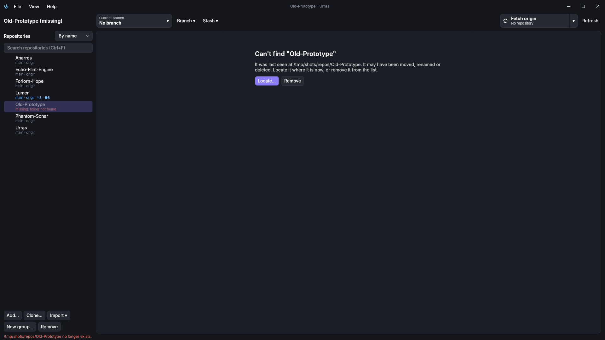<br>
      A repository whose folder is gone: Locate, Clone again or Remove
    </td>
    <td width="50%">
      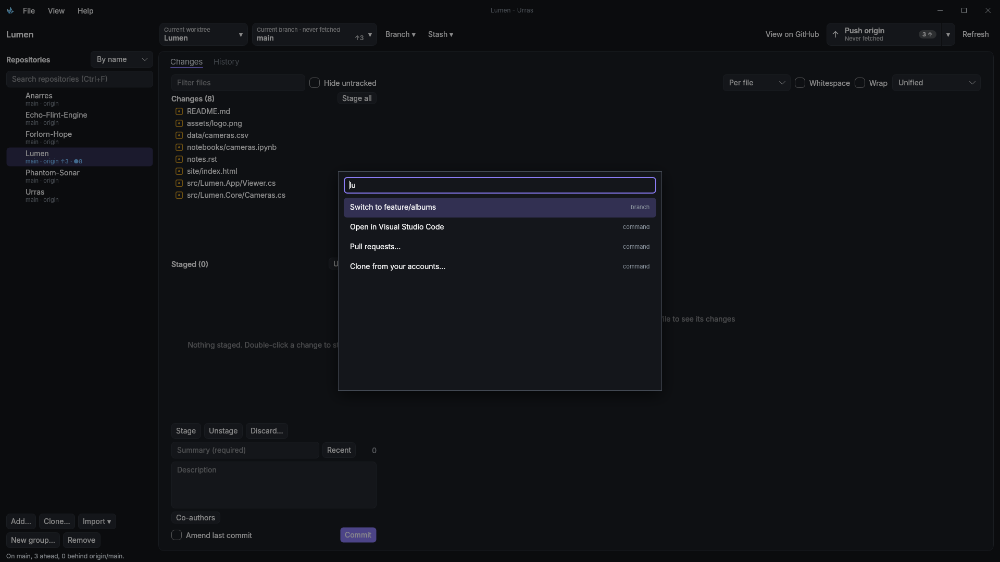<br>
      Quick Launch (Ctrl+P): a repository, branch or command in a few letters
    </td>
  </tr>
  <tr>
    <td width="50%">
      <br>
      A repository's menu: open it elsewhere, view it on GitHub, fetch, pull, pin and group
    </td>
    <td width="50%">
      <br>
      Import: everything in a folder, GitHub Desktop's list and fork choices, or your accounts
    </td>
  </tr>
  <tr>
    <td width="50%">
      <br>
      Choosing which of the repositories found to add
    </td>
    <td width="50%">
      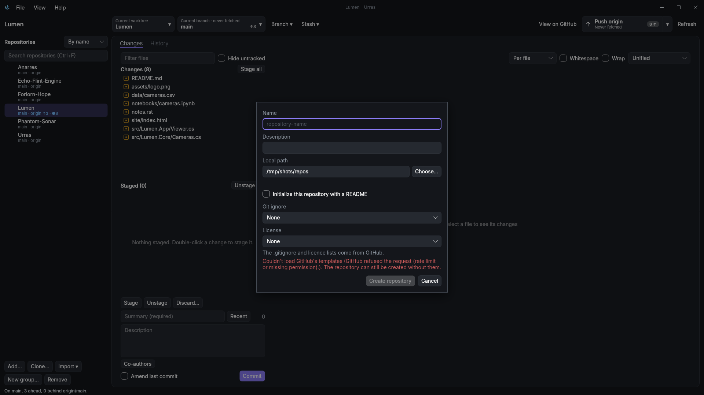<br>
      New repository, with a README, a .gitignore template and a licence
    </td>
  </tr>
  <tr>
    <td width="50%">
      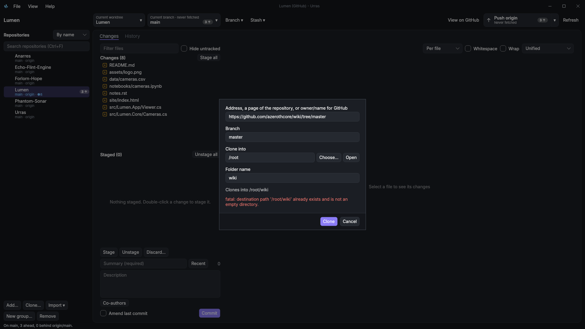<br>
      Clone: an address or a page of it, the branch, where it goes, its name, progress
    </td>
    <td width="50%">
      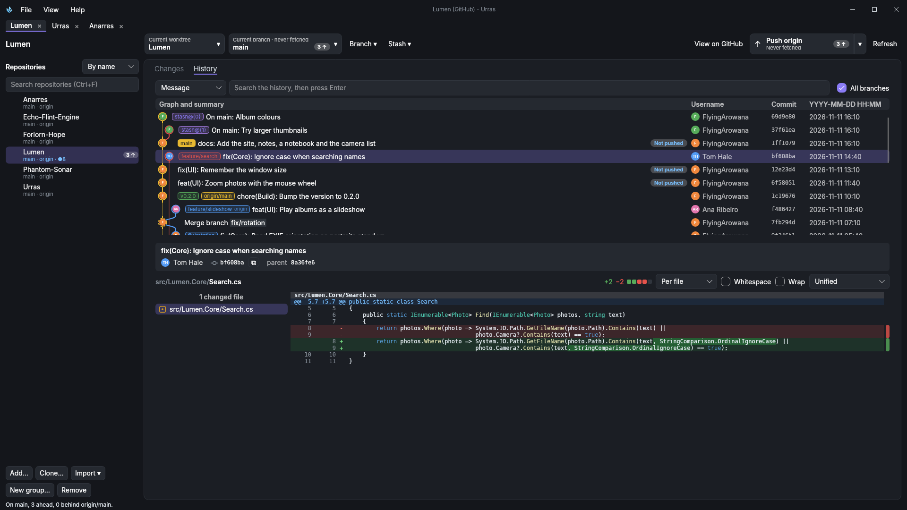<br>
      Repository tabs: each one keeps its page, commit, file and scroll
    </td>
  </tr>
</table>

</details>

<details>
<summary><b>Changes and commits</b></summary>

- Changes: unstaged and staged files, stage and unstage (selected or all), discard with confirmation
- Co-authors on commits (Co-authored-by lines), picked from people in the history, typed as `Name <email>`, or
  found as @username with a GitHub account
- Stage, unstage or discard single lines or whole hunks: select lines in the diff and right-click
- Commit with summary and description, amend the last commit (Ctrl+Enter to commit), and Undo right after
  committing, like GitHub Desktop: the changes go back to staged and the message back in the boxes
- Ignore a new file, every file of its kind, or its folder from its right-click menu (written to `.gitignore`)
- Filter the change list, hide untracked files, and see line-ending problems (checked against `.gitattributes`
  and `.editorconfig`) before they are committed
- Commit message helpers: summary length counter, recent messages, and the repository's commit template
- Uncommitted changes can stay with their branch: put away when you switch, back when you return


<table>
  <tr>
    <td width="50%">
      <br>
      Changes: the files, a diff with word-level colours, its count and change marks, and the commit message
    </td>
    <td width="50%">
      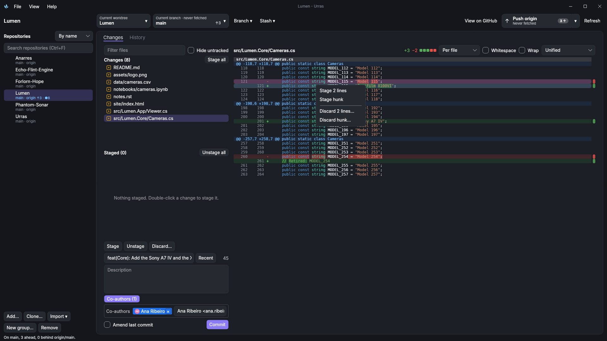<br>
      Staging, unstaging or discarding the selected lines or their hunk
    </td>
  </tr>
  <tr>
    <td width="50%">
      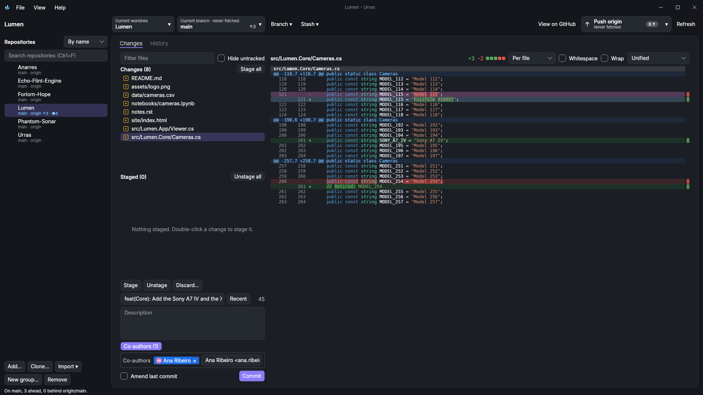<br>
      Co-authors on a commit, from the history, an address or a GitHub @username
    </td>
    <td width="50%">
      <br>
      Filtering the changes by name
    </td>
  </tr>
  <tr>
    <td width="50%">
      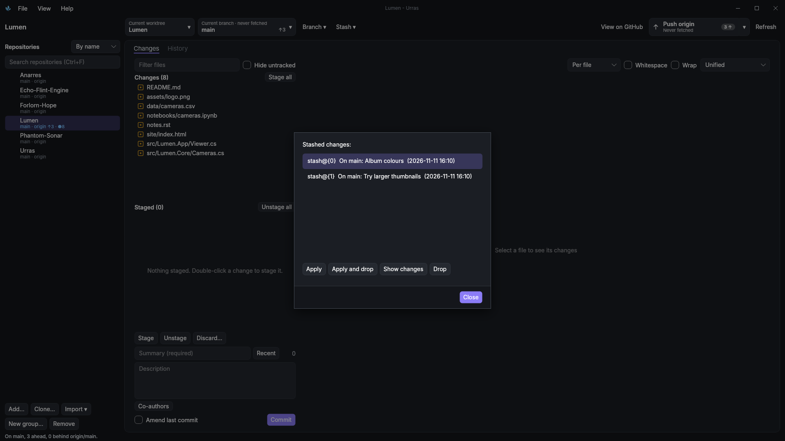<br>
      Stashes: apply, pop, show or drop
    </td>
    <td width="50%">
      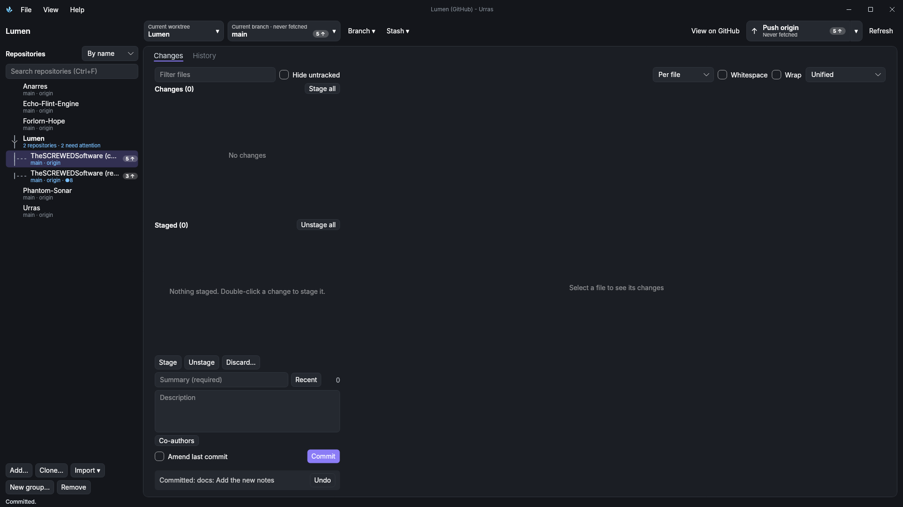<br>
      Undo right after committing: the changes go back to staged, the message to the boxes
    </td>
  </tr>
</table>

</details>

<details>
<summary><b>Diffs</b></summary>

- Diffs for modified, new, deleted and renamed files, as unified (with line numbers), split (side by side) or raw
  `git` output; the choice is saved
- Files rendered, old and new side by side with changed blocks or rows marked (Preview switch): Markdown (HTML
  inside it included), HTML (text and structure, with Open in browser for the real page), CSV/TSV tables, Jupyter
  notebooks (with their output and charts), reStructuredText and AsciiDoc; pictures from the repository (or the
  internet, if chosen), and a Full screen view for previews and images
- "+406 −553" and GitHub's five squares for each diff
- A column of change marks beside each diff and preview: hovering one names its lines ("Lines from 12 - 18 added"),
  clicking it goes there; a file opens at its first change
- Syntax colours for 60+ languages from Visual Studio Code's grammars, in the theme's colours or a scheme such
  as Dark Plus or Monokai (Options > Appearance), word-level highlights in changed lines, optional whitespace and
  CRLF/LF markers, wrapped or scrolling lines
- Commits shown per file (a list of changed files) or combined; images compared side by side, as a swipe or
  as an onion skin


<table>
  <tr>
    <td width="50%">
      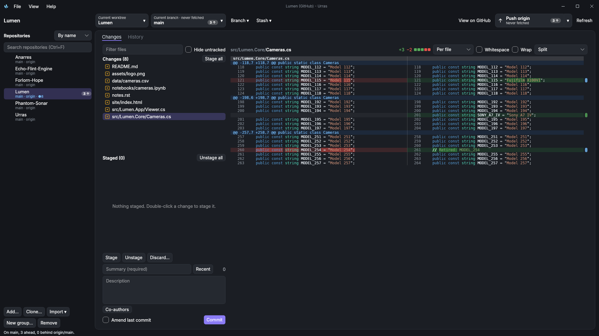<br>
      The split (side by side) diff
    </td>
    <td width="50%">
      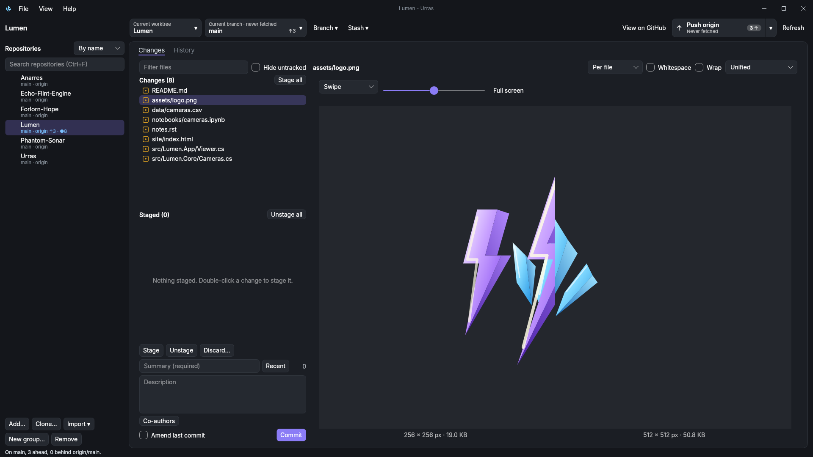<br>
      Images compared as a swipe (or side by side, or as an onion skin)
    </td>
  </tr>
  <tr>
    <td width="50%">
      <br>
      Markdown rendered, pictures and the HTML in it included (Preview)
    </td>
    <td width="50%">
      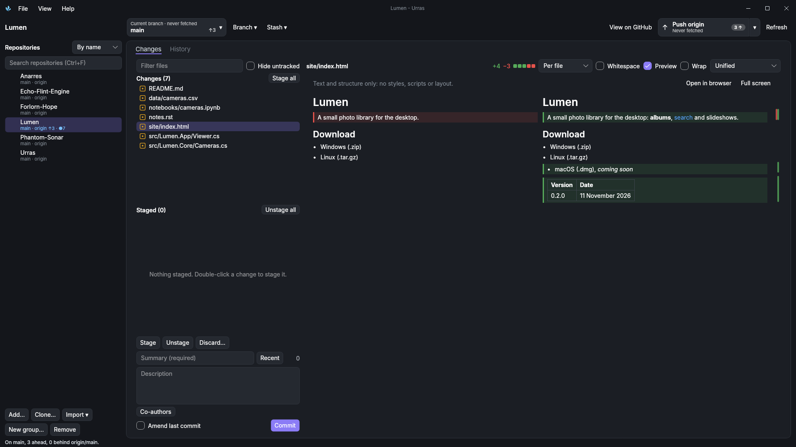<br>
      HTML as a reading view, with Open in browser for the real page
    </td>
  </tr>
  <tr>
    <td width="50%">
      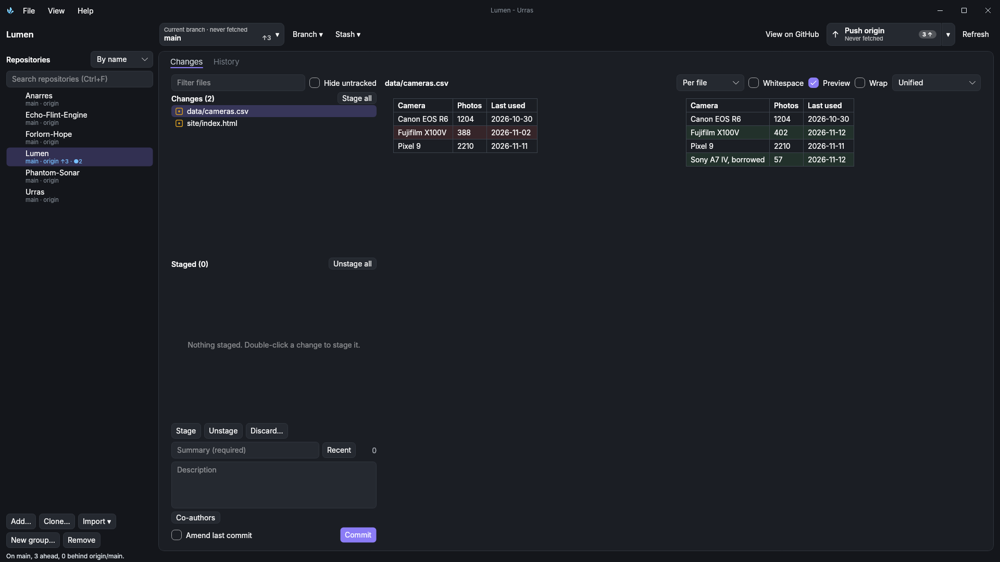<br>
      CSV and TSV as tables, with just the changed rows marked
    </td>
    <td width="50%">
      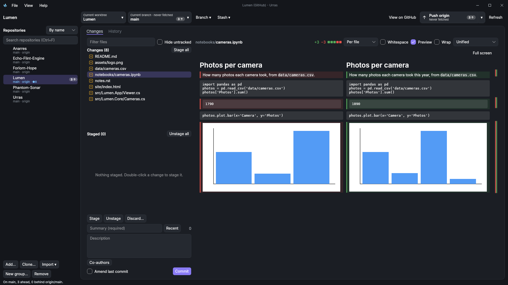<br>
      Jupyter notebooks with their code, output and charts
    </td>
  </tr>
  <tr>
    <td width="50%">
      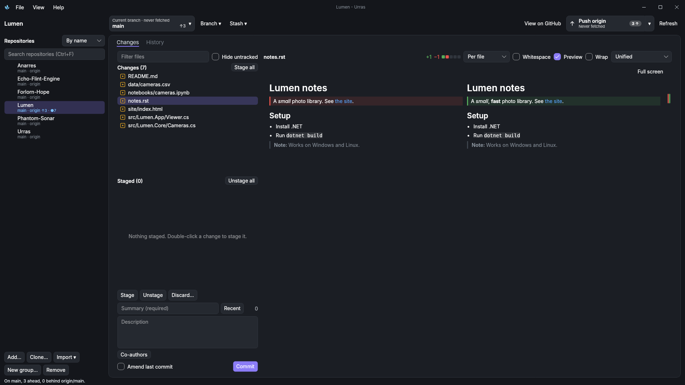<br>
      reStructuredText (and AsciiDoc) rendered
    </td>
    <td width="50%">
      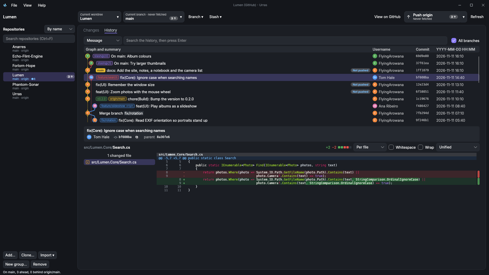<br>
      Code coloured with Visual Studio Code's grammars, here in the Monokai scheme
    </td>
  </tr>
</table>

</details>

<details>
<summary><b>History and the past</b></summary>

- History with the full diff of each commit, a commit graph with branch lanes across every branch, the author's
  picture on each commit, branch labels in their lane's colour (with the remote beside a pushed branch), tags, and
  commits not pushed yet
- Looking into the past: history of a file or folder, blame, browsing the files at any commit, searching commits
  by message, author, file or content, comparing two commits (Ctrl+click) or a branch, and the reflog for
  finding lost commits
- Statistics: contributors, when commits happen and which files change most


<table>
  <tr>
    <td width="50%">
      <br>
      The graph: lanes, branch labels in their lane's colour, authors and commits not pushed yet
    </td>
    <td width="50%">
      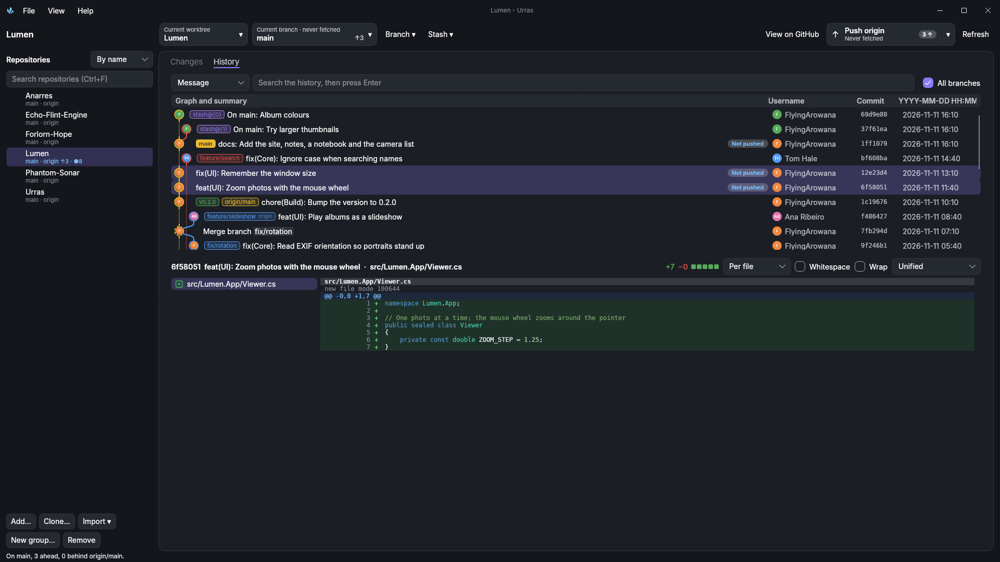<br>
      Two commits selected (Ctrl+click) are compared
    </td>
  </tr>
  <tr>
    <td width="50%">
      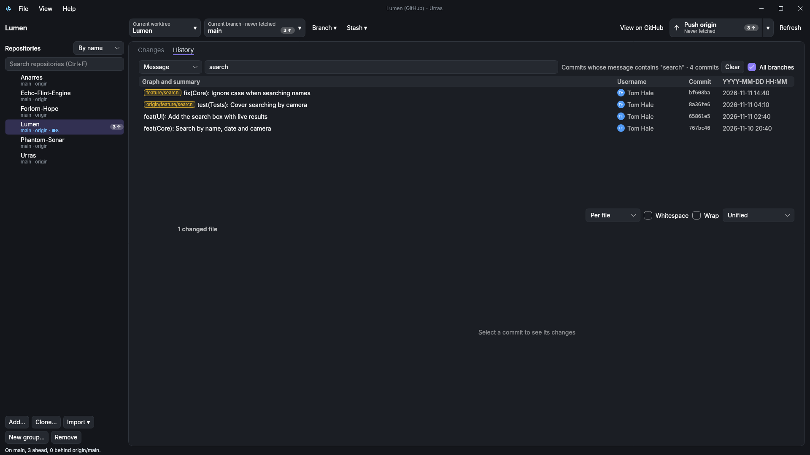<br>
      Searching the history by message, author, file or content
    </td>
    <td width="50%">
      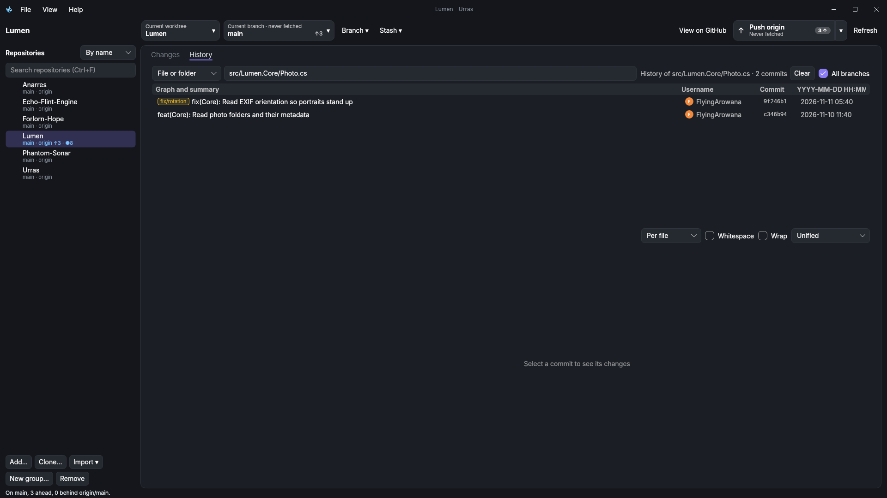<br>
      The history of one file or folder
    </td>
  </tr>
  <tr>
    <td width="50%">
      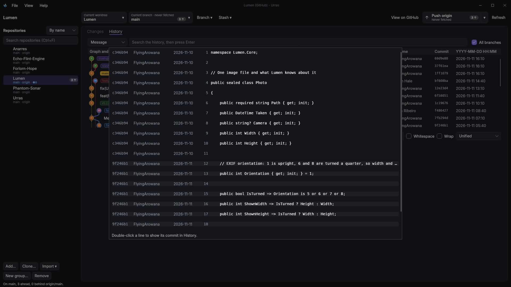<br>
      Blame: who changed each line, and when
    </td>
    <td width="50%">
      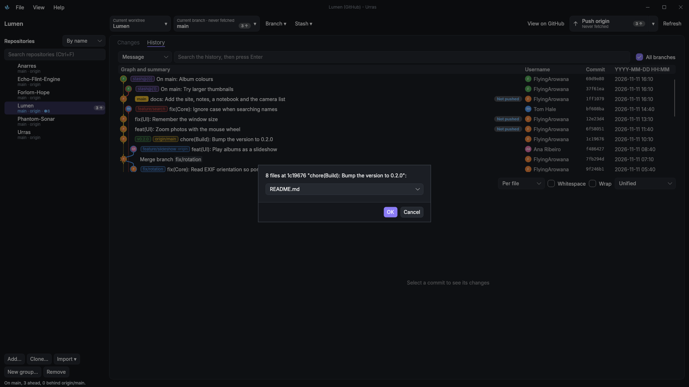<br>
      Browsing the files at any commit
    </td>
  </tr>
  <tr>
    <td width="50%">
      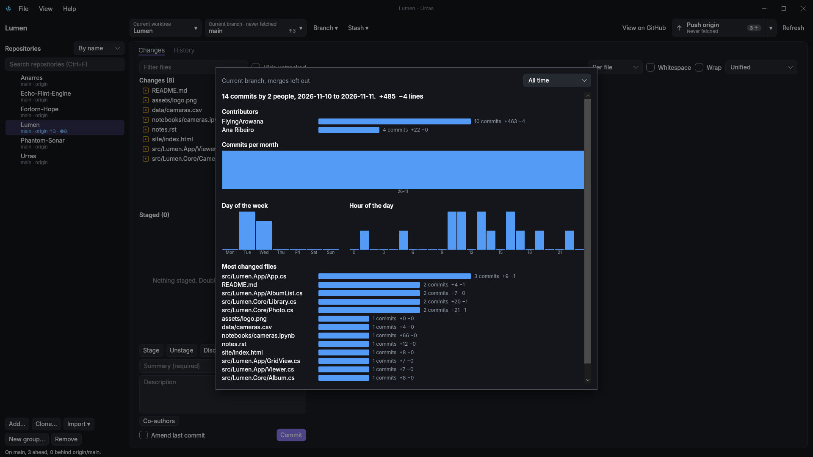<br>
      Statistics: contributors, when commits happen and which files change most
    </td>
    <td width="50%">
      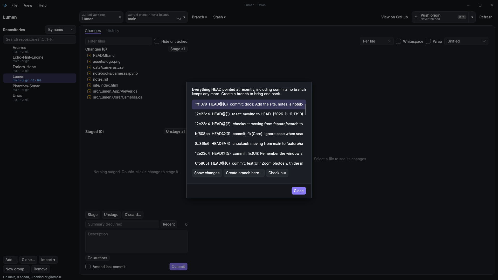<br>
      The reflog, for finding lost commits
    </td>
  </tr>
  <tr>
    <td width="50%">
      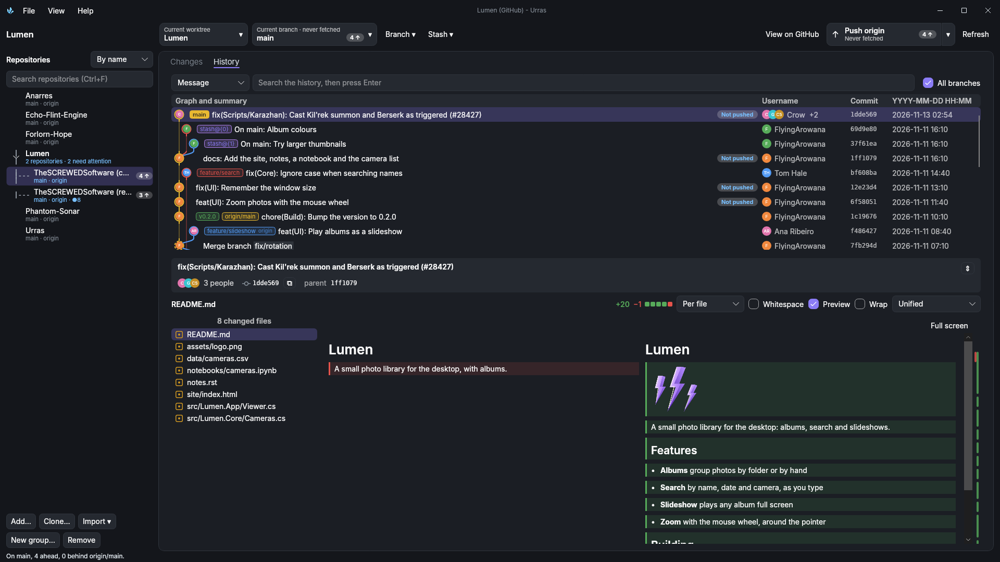<br>
      A commit's details: its message, author and co-authors, hash, parent and CI result
    </td>
  </tr>
</table>

</details>

<details>
<summary><b>Branches, syncing and publishing</b></summary>

- Branches: switch, create, rename (on the remote too), delete, check out remote branches; remotes added,
  renamed, pointed elsewhere or removed (Branch > Remotes)
- Fetch, pull and push from one button, like GitHub Desktop's: an arrow up or down, the ahead and behind counts,
  and when it last fetched; the first push publishes the branch
- Publish repository: a repository with no remote is made on GitHub, GitLab or Gitea (under your account or an
  organization, private or public), added as origin and pushed
- Force push after a rewrite: when a pushed branch's commits were rewritten (authors fixed, amended, rebased), Sync
  offers to replace the remote's old copies instead of pulling them back in; force pushes use --force-with-lease
- Background fetching of every repository (Settings)
- Tags, checking out a commit, revert, reset the branch to a commit (keeping the changes staged or unstaged, or
  throwing them away after tagging where it was), cherry-pick, stashes, merge and rebase
- CI results in a commit's details (GitHub checks and statuses, GitLab pipelines) when you're signed in
- Bisect from History with a banner to mark commits; submodules, worktrees and Git LFS (with locks) from
  the Branch menu
- Interactive rebase from History: reorder, reword, edit, squash, fix up or drop commits, with a backup tag
- Conflict helper: a banner while a merge, rebase, cherry-pick or revert is stopped, taking one side or marking
  files resolved, then Continue or Abort
- Conflict view: both sides of every conflict next to each other, a choice per conflict and the result below
- Repository settings: line-ending rules written to `.gitattributes` and `.editorconfig`, and normalizing
  existing files after previewing them


<table>
  <tr>
    <td width="50%">
      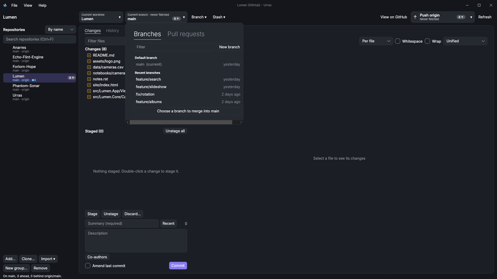<br>
      The branch box: the default and recent branches, a filter, New branch and pull requests
    </td>
    <td width="50%">
      <br>
      The Branch menu: merge, rebase, compare, pull requests, tags, reflog and more
    </td>
  </tr>
  <tr>
    <td width="50%">
      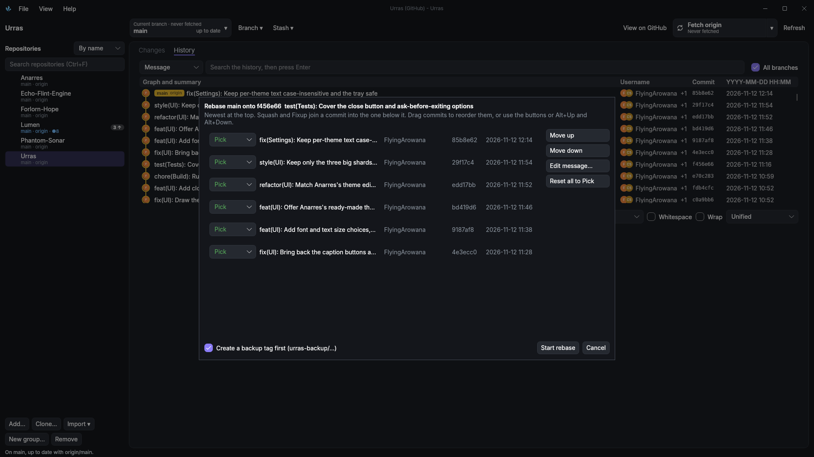<br>
      Interactive rebase: reorder, reword, edit, squash, fix up or drop
    </td>
    <td width="50%">
      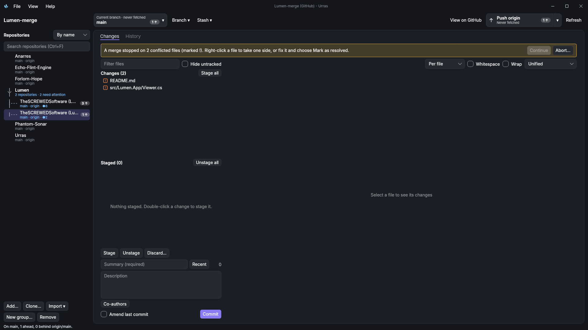<br>
      A stopped merge: the banner with Continue and Abort, and the conflicted files
    </td>
  </tr>
  <tr>
    <td width="50%">
      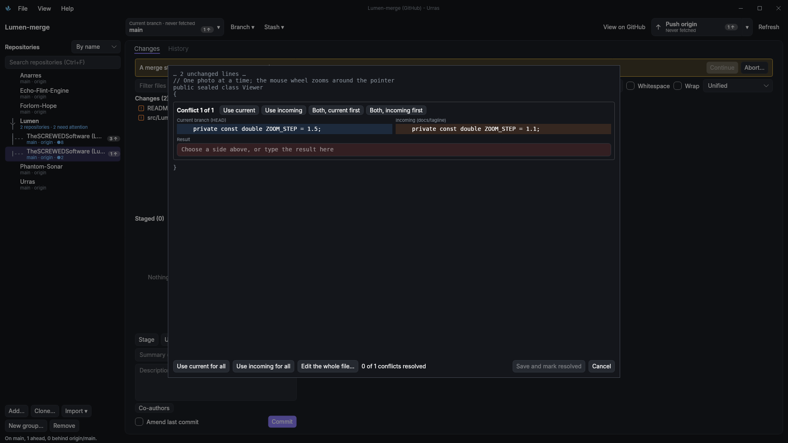<br>
      The conflict view: both sides of every conflict, a choice for each, and the result
    </td>
    <td width="50%">
      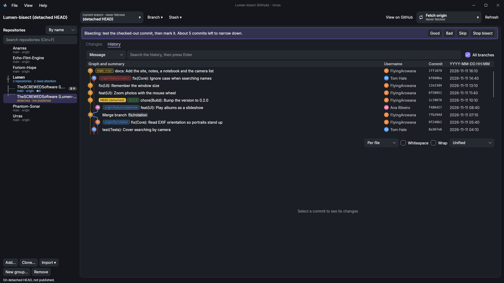<br>
      Bisect: the banner to mark commits good or bad
    </td>
  </tr>
  <tr>
    <td width="50%">
      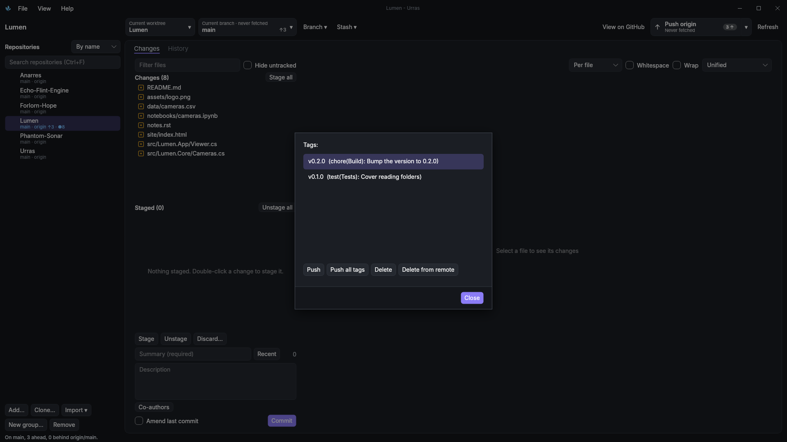<br>
      Tags: create, push and delete
    </td>
    <td width="50%">
      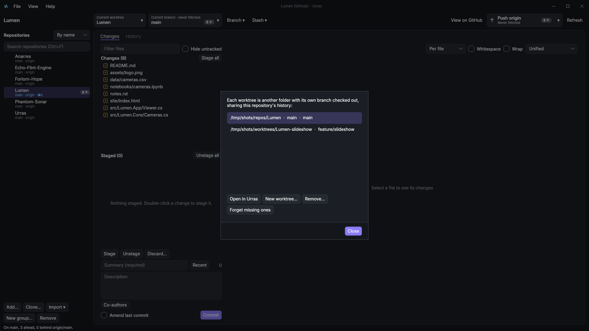<br>
      Worktrees: open, add and remove
    </td>
  </tr>
  <tr>
    <td width="50%">
      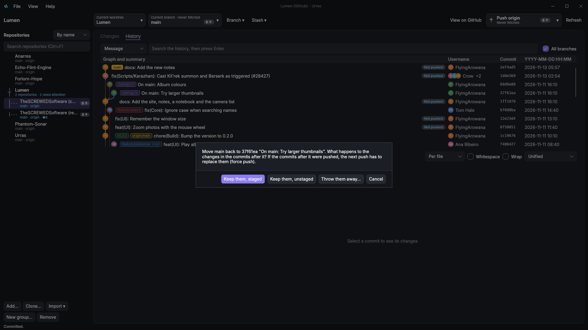<br>
      Resetting to a commit: keep the changes staged or unstaged, or throw them away
    </td>
    <td width="50%">
      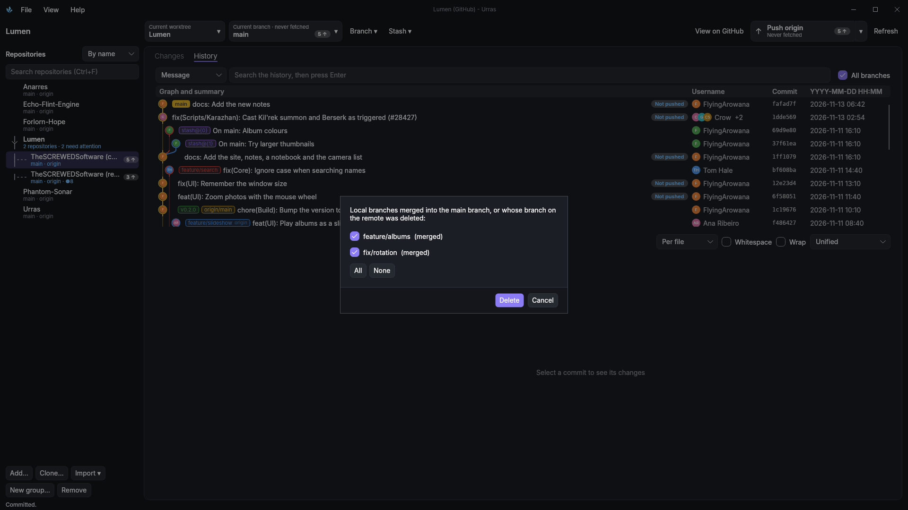<br>
      Cleaning up branches merged into main or gone from the remote
    </td>
  </tr>
  <tr>
    <td width="50%">
      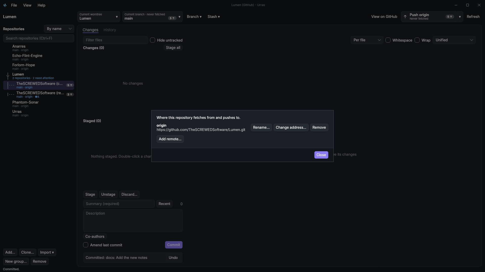<br>
      Remotes: add, rename, change the address of or remove
    </td>
  </tr>
</table>

</details>

<details>
<summary><b>Accounts and hosting sites</b></summary>

- Accounts on GitHub, GitHub Enterprise, GitLab, Gitea (Forgejo, Codeberg), Bitbucket and Bitbucket Server,
  with tokens in the system's credential store: profile pictures, pull requests (list, check out, create),
  notifications, and cloning your repositories
- Sign in to GitHub and gitlab.com through the browser, like GitHub Desktop; GitHub Enterprise and your own
  GitLab too once registered
  ([docs/oauth.md](docs/oauth.md)), and a personal access token for everything else
- View a repository on GitHub, GitLab, Bitbucket or Codeberg; forks ask once, like GitHub Desktop, whether they
  contribute to the parent or are for your own purposes, and say what you can push to

</details>

<details>
<summary><b>Look, settings and tools</b></summary>

- Settings backed up every day for a week (`%APPDATA%\Urras\backups`), and unexpected errors written to
  `crash.log` instead of closing Urras
- Custom commands: run builds, scripts or other tools from the menus, with the repository, branch, file or
  commit filled in
- Options: accounts, external editor and shell (or your own), Git name, email and default branch, theme, font
  and text size, date and time formats, tab size, pictures in previews, which questions to ask, what happens to
  changes when switching branch, background fetch
- Close button can minimise Urras to the system tray (Windows and macOS) instead of exiting, and Urras can ask
  before exiting
- AI assistant with the service of your choice (OpenAI-compatible, Anthropic or a command-line agent): commit
  messages from the staged changes, explaining commits, conflict suggestions; off by default
- Git log panel showing the commands that change something, and any that fail, with Git's output
- Failed commands open a window with Git's error, like GitHub Desktop (can be turned off)
- Commit signing with an SSH or GPG key (Options > Git), for GitHub's Verified badge
- A daily check for a new Urras on GitHub, offered from the title bar; Help > Check for updates asks at once
- Keyboard shortcuts listed under Help (F1); starting Urras again brings the open one forward
- Discarded files are copied first and kept for a week, since Git can't undo a discard
- Themes: built-in Dark and Light, twelve ready-made ones (Frost, Fel, Horde, Alliance, Parchment, Anarres,
  GitHub, GitLab, SourceGit, Fork) and your own, in theme files shared with Anarres
  ([docs/themes.md](docs/themes.md)); any of them can be edited and restored, and any installed font and a text
  size set for every theme or just one
- Its own title bar on Windows, with minimise, maximise and close in the theme's colours


<table>
  <tr>
    <td width="50%">
      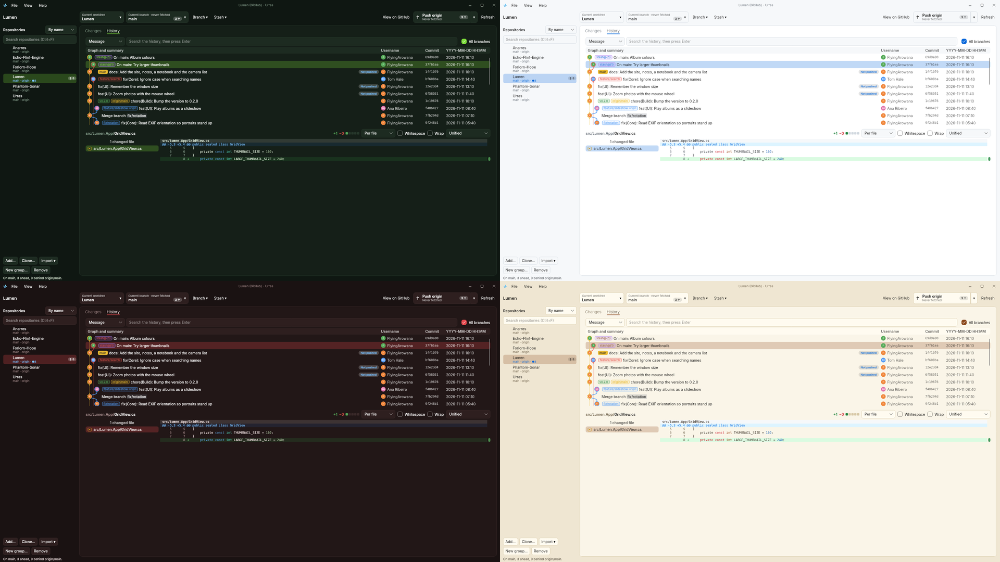<br>
      Ready-made themes: Fel, GitHub Light, Horde and Parchment of the twelve
    </td>
    <td width="50%">
      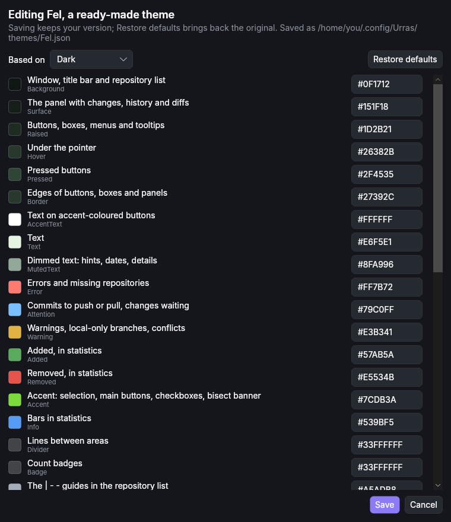<br>
      Editing a theme, ready-made ones included; Restore defaults brings back the original
    </td>
  </tr>
  <tr>
    <td width="50%">
      <br>
      Options: themes, the text size and font for every theme or one, and diffs
    </td>
    <td width="50%">
      <br>
      Options: your Git name, email, default branch and commit signing
    </td>
  </tr>
  <tr>
    <td width="50%">
      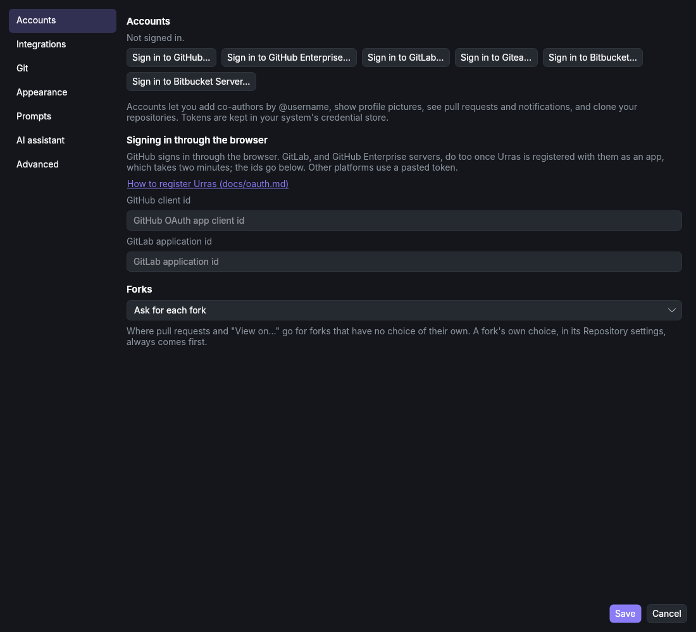<br>
      Options: sign in to GitHub, GitLab, Gitea or Bitbucket, and what forks do
    </td>
    <td width="50%">
      <br>
      Options: your editor and shell for "Open in…"
    </td>
  </tr>
  <tr>
    <td width="50%">
      <br>
      Options: which questions to ask, and what happens to changes when switching branch
    </td>
    <td width="50%">
      <br>
      Options: the close button, update checks, background fetch and commit checks
    </td>
  </tr>
  <tr>
    <td width="50%">
      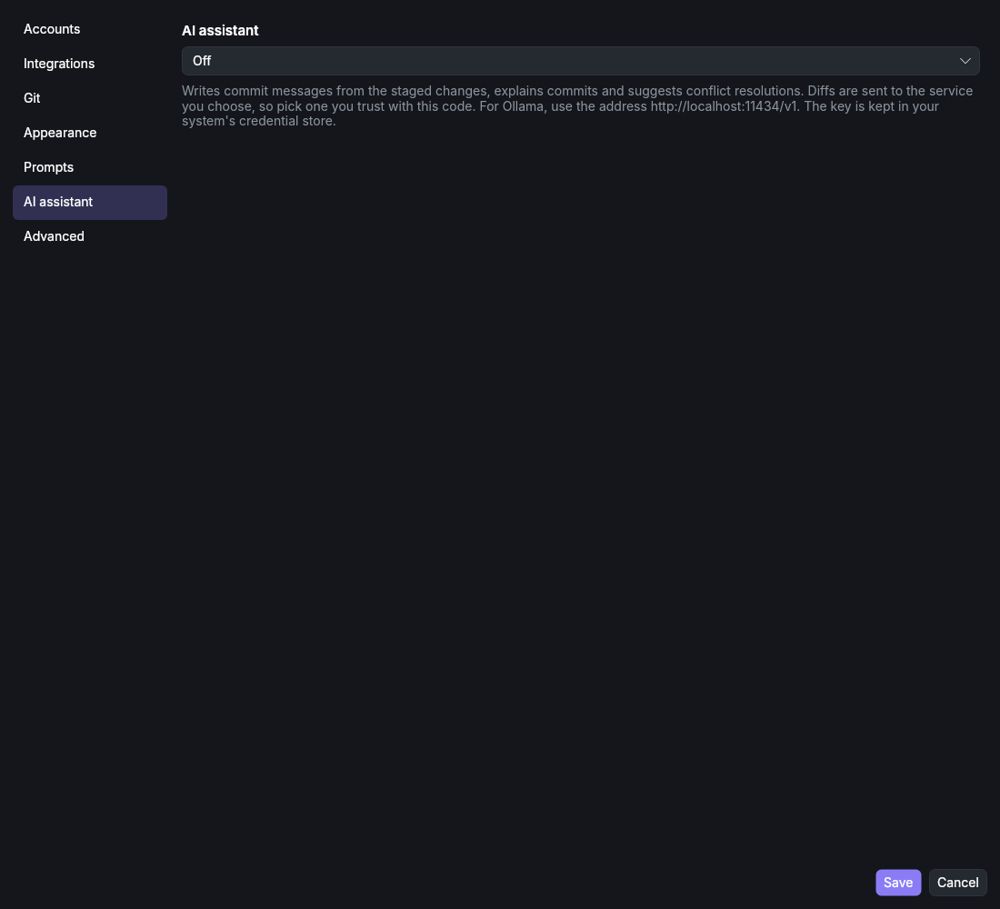<br>
      Options: an AI assistant for commit messages, off unless you choose one
    </td>
    <td width="50%">
      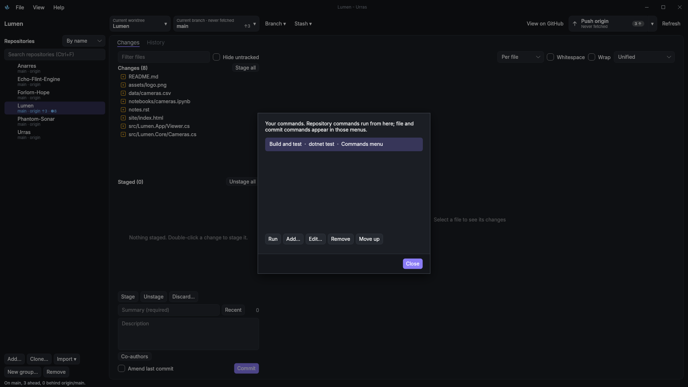<br>
      Custom commands, run from the menus with the repository, branch, file or commit filled in
    </td>
  </tr>
  <tr>
    <td width="50%">
      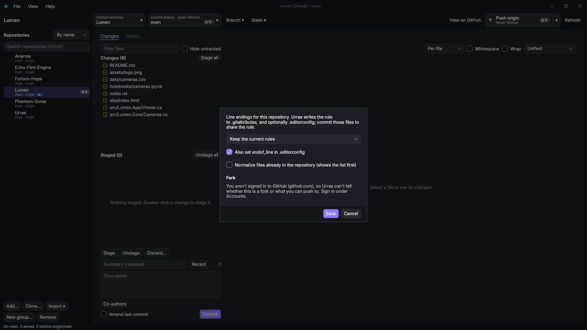<br>
      Repository settings: line endings in .gitattributes and .editorconfig
    </td>
    <td width="50%">
      <br>
      The Git log: commands that change something, and any that fail
    </td>
  </tr>
  <tr>
    <td width="50%">
      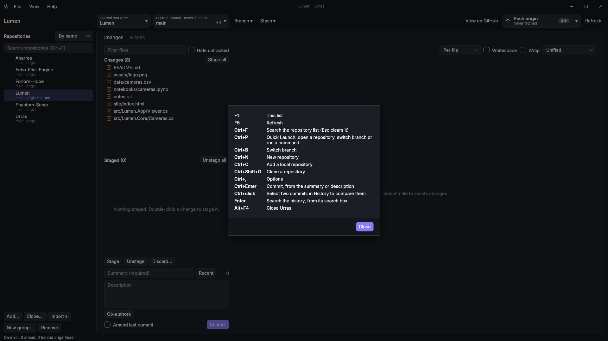<br>
      Keyboard shortcuts (F1)
    </td>
  </tr>
</table>

</details>

## For maintainers: build types and releases

<details>
<summary><b>Build types</b></summary>

Builds default to Release, which is optimised and still has full debug symbols, so breakpoints and stack traces
work (.NET's equivalent of CMake's RelWithDebInfo). Use `-c Debug` for an unoptimised build. Visual Studio and Rider
pick the configuration in their toolbar instead; choose Release there once and they remember it.

</details>

<details>
<summary><b>Publishing a release</b></summary>

1. Raise `<Version>` in `src/Urras.App/Urras.App.csproj` (for example to `0.2.0`), commit and push.
2. On GitHub, open **Actions › Release › Run workflow** and pick the branch.

The workflow tests Urras, builds the Windows and Linux downloads, tags the commit `v0.2.0` and publishes the release
with notes made from the changes since the last one. Tick **pre-release**, or use a version with a hyphen such as
`0.2.0-beta.1`, to mark it as a pre-release. A version that is already released stops the run before anything is
built.

</details>

## Project layout and settings

```
src/Urras.Core/          Git commands, output parsers, settings. No UI.
src/Urras.App/           Avalonia user interface.
tests/Urras.Core.Tests/  Tests for Urras.Core, with a small built-in runner.
tests/Urras.App.Tests/   Interface tests, run without showing any window.
tools/Urras.Standards/   The coding standards check.
```

Settings (the repository list and everything in Options) are stored in `%APPDATA%\Urras\settings.json` on Windows
and `~/.config/Urras/settings.json` on Linux. Next to them are the daily settings backups, `crash.log` and
`startup.log`.

## Contributing

Read [CONTRIBUTING.md](CONTRIBUTING.md) before opening a pull request: it covers the coding standards, commit
messages, tests and the contributor terms. AI-assisted pull requests are allowed, but must be disclosed in the pull
request template.

## Credits

- [Avalonia](https://github.com/AvaloniaUI/Avalonia) (MIT) for the user interface.
- [TextMateSharp](https://github.com/danipen/TextMateSharp) (MIT) for colouring code with Visual Studio Code's
  language grammars and colour schemes, which come with it under their own licences.

## License

Copyright (C) 2026 TheSCREWEDSoftware

Urras is free software: you can redistribute it and/or modify it under the terms of the GNU Affero General Public
License as published by the Free Software Foundation, either version 3 of the License, or (at your option) any later
version.

Urras is distributed in the hope that it will be useful, but WITHOUT ANY WARRANTY; without even the implied warranty
of MERCHANTABILITY or FITNESS FOR A PARTICULAR PURPOSE. See the GNU Affero General Public License for more details.

You should have received a copy of the GNU Affero General Public License along with Urras, in [LICENSE](LICENSE). If
not, see <https://www.gnu.org/licenses/>.
